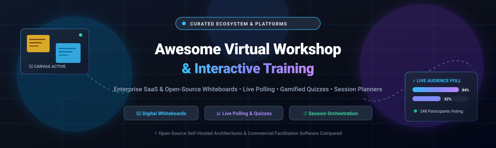

# Awesome-Virtual-Workshop-Interactive-Training

<p align="center">
  
</p>

# 🚀 Awesome Virtual Workshop & Interactive Training 🎓

<a href="https://github.com/ishandutta2007/Awesome-Awesome-Awesome"></a><a href="https://discord.gg/jc4xtF58Ve"></a>
[](https://awesome.re)
[](https://creativecommons.org/publicdomain/zero/1.0/)
[](https://github.com/ishandutta2007/Awesome-Virtual-Workshop-Interactive-Training/pulls)
[](https://github.com/ishandutta2007/Awesome-Virtual-Workshop-Interactive-Training)
<a href="https://github.com/ishandutta2007"></a>

> 🌟 **A comprehensive, curated directory of the world's best Virtual Workshop and Interactive Training platforms.** Discover enterprise SaaS facilitators, real-time visual collaboration canvases, interactive quizzes, live audience polling, and 100% self-hosted, privacy-first open-source alternatives.

---

## 📑 Table of Contents

- [🌐 Sector Overview & Market Dynamics](#-sector-overview--market-dynamics)
- [🏢 SaaS & Hosted Commercial Platforms](#-saas--hosted-commercial-platforms)
- [🔓 Open-Source Software](#-open-source-software)
- [📊 Comprehensive Comparison at a Glance](#-comprehensive-comparison-at-a-glance)
- [🎯 Choosing the Right Stack for Your Workshop](#-choosing-the-right-stack-for-your-workshop)
- [🤝 Contributing](#-contributing)
- [💖 Support & Sponsorship](#-support--sponsorship)
- [⭐ Star History](#-star-history)
- [📄 License](#-license)

---

## 🌐 Sector Overview & Market Dynamics

The global market for virtual workshops, interactive training, and enterprise e-learning is valued at approximately **$150B–$157B in 2026** (with related virtual event platforms and immersive training expanding toward **$335B+ by 2030** at an annual CAGR exceeding 18–21%). 

The sector exhibits **moderate fragmentation across functional sub-categories** rather than a single winner-take-all monopoly: while visual whiteboarding demonstrates high consolidation around a few dominant category leaders (e.g., Miro and Mural) and live video conferencing is anchored by giants (Zoom, Microsoft Teams, Cisco Webex), audience engagement, interactive gamification, technical hands-on sandboxes, and agenda orchestration remain vibrantly fragmented with fast-growing specialized SaaS vendors and privacy-conscious open-source projects.

---

## 🏢 SaaS & Hosted Commercial Platforms

Commercial cloud solutions ranked in descending order by estimated company valuation / scale and annual recurring revenue (ARR).

| Product | Company Scale / Valuation / ARR | Category | Starting Paid Tier Pricing | Free Tier / Trial Limits | Key Highlights |
| :--- | :--- | :--- | :--- | :--- | :--- |
| [**Miro**](https://miro.com/) | **~$17.5B Valuation** (~$600M+ ARR, 100M+ users) | 🎨 Collaborative Whiteboard | **$8 / member / month** (billed annually at $96/yr) | **Free Forever:** Unlimited team members, but strictly limited to **3 editable boards** (older boards convert to view-only) | Infinite collaborative canvas, massive template library, built-in voting, timers, video chat, and enterprise integrations. |
| [**Kahoot! 360**](https://kahoot.com/business/) | **$1.7B Valuation** (Acquired private by Goldman Sachs / KIRKBI) | 🎮 Gamified Quizzes & Training | **$19 / host / month** (billed annually at $228/yr for standard business tier) | **Free Forever (Kahoot! Basic):** Unlimited self-created quizzes, but capped at **10 live participants per session** | Gold standard for gamified learning, live leaderboards, employee onboarding challenges, and mobile microlearning. |
| [**Mural**](https://mural.co/) | **$2.0B Valuation** (~$125M–$189M ARR) | 🎨 Collaborative Whiteboard | **$9.99 / member / month** (billed annually at $119.88/yr) | **Free Forever:** Unlimited team members & visitors, but restricted to **3 active editable murals** | Facilitation superpower features: private mode, custom timers, design-thinking workflows, and agile sprint ceremonies. |
| [**Slido**](https://www.slido.com/) | **Acquired by Cisco** (Part of Cisco Webex Collaboration Suite) | 📊 Live Polling & Q&A | **$12.50 / month** ($150 / year billed annually for Engage plan) | **Free Forever (Basic):** Up to **100 participants per event**, unlimited Q&A, and up to **3 polls per event** | Seamless native integration into Zoom, Webex, and Microsoft Teams for crowdsourced live Q&A, rating polls, and word clouds. |
| [**Mentimeter**](https://www.mentimeter.com/) | **~$100M+ Scale** (Profitable European SaaS scale-up, >$50M ARR) | 📈 Interactive Presentations & Polls | **$11.99 / presenter / month** (billed annually at $143.88/yr for Basic) | **Free Forever:** Unlimited presentations and slides, but strictly capped at **50 participants / month** | Turn passive presentations into interactive dialogues with live smartphone voting, quiz competitions, and word clouds. |
| [**SessionLab**](https://www.sessionlab.com/) | **Bootstrapped / Early VC** (TinySeed / Startup Wise Guys portfolio) | ⏱️ Workshop Agenda Orchestration | **$9 / month** (billed annually at $108/yr for Individual plan) | **Free Forever:** 1 workspace with up to **3 active session plans** and 50 AI requests (view-only sharing; no real-time co-editing) | Visual drag-and-drop agenda designer with dynamic auto-recalculating time blocks and an expansive library of facilitation exercises. |

---

## 🔓 Open-Source Software

Community-driven, self-hosted alternatives for workshops, visual collaboration, live audience feedback, and interactive learning. Sorted in descending order by GitHub stargazers count.

### 1. [Excalidraw](https://github.com/excalidraw/excalidraw) [](https://github.com/excalidraw/excalidraw/stargazers)
* **Stack:** TypeScript, React, Canvas API | **License:** MIT  
* **Type:** 🎨 Virtual Whiteboard & Sketching Canvas  
* **Overview:** The premier open-source virtual whiteboard with a signature hand-drawn aesthetic. Features real-time end-to-end encrypted collaboration, infinite canvas, custom component libraries, export to SVG/PNG, and self-hostable Docker images. Extensively used in remote design sprints, engineering architecture reviews, and interactive coaching sessions.

### 2. [AFFiNE](https://github.com/toeverything/AFFiNE) [](https://github.com/toeverything/AFFiNE/stargazers)
* **Stack:** TypeScript, Rust, React | **License:** MIT  
* **Type:** 📝 All-in-One Workspace & Infinite Whiteboard  
* **Overview:** A modern, privacy-first workspace uniting structured markdown notes, Kanban task boards, and an unbounded whiteboard canvas on a single page. Fully local-first and self-hostable via Docker, making it ideal for facilitators who want unified agendas, participant note-taking, and brainstorming exercises without SaaS vendor lock-in.

### 3. [tldraw](https://github.com/tldraw/tldraw) [](https://github.com/tldraw/tldraw/stargazers)
* **Stack:** TypeScript, React | **License:** Apache-2.0 / Custom  
* **Type:** 🖌️ Infinite Collaborative Canvas & SDK  
* **Overview:** A collaborative digital whiteboard with multiplayer multiplayer state synchronization, rich shape primitives, sticky notes, frames, and an embeddable canvas engine. Highly extensible for creating custom workshop facilitation templates and proprietary interactive training toolkits.

### 4. [BigBlueButton](https://github.com/bigbluebutton/bigbluebutton) [](https://github.com/bigbluebutton/bigbluebutton/stargazers)
* **Stack:** Scala, Java, JavaScript, WebRTC | **License:** LGPL-3.0  
* **Type:** 🎓 Virtual Classroom & Interactive Training Web Conferencing  
* **Overview:** Enterprise-grade open-source virtual classroom platform built specifically for online learning and training. Includes multi-user whiteboard sharing, breakout rooms, integrated polling, public and private chat, screen sharing, and emoji feedback indicators.

### 5. [draw.io (diagrams.net)](https://github.com/jgraph/drawio) [](https://github.com/jgraph/drawio/stargazers)
* **Stack:** JavaScript, Electron, HTML5 | **License:** Apache-2.0  
* **Type:** 📐 Diagramming & Technical Facilitation  
* **Overview:** Industry-standard diagramming suite supporting flowcharts, swimlane diagrams, process maps, and architecture schemas. Runs client-side or self-hosted with zero user tracking, complete offline capability, and integration into Google Drive, OneDrive, and Nextcloud.

### 6. [Whitebophir (WBO)](https://github.com/lovasoa/whitebophir) [](https://github.com/lovasoa/whitebophir/stargazers)
* **Stack:** Node.js, JavaScript, HTML5 Canvas | **License:** AGPL-3.0  
* **Type:** 🖊️ Lightweight Real-time Collaborative Whiteboard  
* **Overview:** A minimalist, zero-bloat collaborative whiteboard server where multiple users can draw, write, and drop images simultaneously on an unbounded canvas with real-time websocket synchronization. Perfect for low-bandwidth workshops and instant ad-hoc breakout sketch sessions.

### 7. [Claper](https://github.com/ClaperCo/Claper) [](https://github.com/ClaperCo/Claper/stargazers)
* **Stack:** Elixir, Phoenix, LiveView, TailwindCSS | **License:** AGPL-3.0  
* **Type:** 📊 Interactive Presentation & Audience Engagement  
* **Overview:** Modern, open-source alternative to Slido and Mentimeter. Presenters upload presentations and interact with the audience via live polls, emoji reactions, upvoted Q&A sessions, and gamified quizzes directly in participants' mobile browsers without app downloads.

### 8. [ClassQuiz](https://github.com/mawoka-myblock/ClassQuiz) [](https://github.com/mawoka-myblock/ClassQuiz/stargazers)
* **Stack:** Python, Svelte, Rust, PostgreSQL | **License:** MPL-2.0  
* **Type:** 🎯 Gamified Quiz Platform  
* **Overview:** A self-hostable Kahoot! alternative tailored for educators, corporate workshops, and live seminar icebreakers. Facilitators launch timed multiple-choice questions, award points based on speed and accuracy, and project a real-time competitive leaderboard to motivate engagement.

### 9. [Educates](https://github.com/educates/educates-training-platform) [](https://github.com/educates/educates-training-platform/stargazers)
* **Stack:** Go, Kubernetes, Docker, Python | **License:** Apache-2.0  
* **Type:** 💻 Hands-on Interactive Technical Labs  
* **Overview:** Purpose-built platform for hosting scalable, hands-on technical workshops and bootcamps. Deploys containerized sandbox environments for each attendee on Kubernetes, featuring side-by-side terminal consoles, an embedded VS Code IDE, and Markdown instruction cards.

### 10. [NeoBoard](https://github.com/nordeck/matrix-neoboard) [](https://github.com/nordeck/matrix-neoboard/stargazers)
* **Stack:** TypeScript, React, Matrix Widget API | **License:** Apache-2.0  
* **Type:** 🛡️ Secure Whiteboard Widget for Matrix / Element  
* **Overview:** A collaborative whiteboard widget developed by Nordeck for the Matrix protocol. Enables teams, government entities, and enterprises to conduct visual brainstorming, planning, and interactive workshops with strict end-to-end security and data residency compliance.

### 11. [SessionPlaner](https://github.com/evoWeb/sessionplaner) [](https://github.com/evoWeb/sessionplaner/stargazers)
* **Stack:** PHP, TypeScript, Fluid | **License:** GPL-2.0  
* **Type:** 📅 Workshop Session & BarCamp Planner  
* **Overview:** An open-source session scheduler specifically designed for unconferences, BarCamps, agile training days, and multi-track community workshops. Manages time slots, rooms, facilitator schedules, and attendee voting on proposed topics.

### 12. [SessionPlan](https://github.com/tim-peters/sessionplan) [](https://github.com/tim-peters/sessionplan/stargazers)
* **Stack:** HTML5, JavaScript, URL State Encoding | **License:** MIT  
* **Type:** ⏱️ Client-Side Session & Agenda Planner  
* **Overview:** A zero-backend, privacy-first alternative to SessionLab where workshop agenda timelines, activity blocks, and timing adjustments are encoded entirely within the browser URL. No accounts, cookies, or database requirements.

### 13. [OpenFresque Event Manager](https://github.com/openfresque/event-manager-core) [](https://github.com/openfresque/event-manager-core/stargazers)
* **Stack:** Ruby on Rails, PostgreSQL | **License:** AGPL-3.0  
* **Type:** 🌿 Workshop Management & Facilitation Logistics  
* **Overview:** Built by the OpenFresque community for non-profit organizations and collective-intelligence workshops (such as Climate Fresk sessions). Manages workshop ticketing, facilitator assignment, participant onboarding, and collaborative exercise scheduling.

### 14. [open.mentimeter](https://github.com/Rishi-ZAiFi/open.mentimeter) [](https://github.com/Rishi-ZAiFi/open.mentimeter/stargazers)
* **Stack:** React, Node.js, Socket.io | **License:** MIT  
* **Type:** 📡 Air-Gapped Local-Network Audience Polling  
* **Overview:** A local-first audience interaction app that runs offline over Wi-Fi or LAN. Allows speakers and corporate trainers to conduct live word clouds, Q&A upvoting, and quizzes in classified or air-gapped workshop spaces with zero internet reliance.

### 15. [Nextcloud Pulse](https://github.com/hotochan123/nextcloud-pulse) [](https://github.com/hotochan123/nextcloud-pulse/stargazers)
* **Stack:** PHP, Vue.js, Nextcloud App API | **License:** AGPL-3.0  
* **Type:** ☁️ Nextcloud Integrated Live Polls & Quizzes  
* **Overview:** An open-source interactive polling and quiz app embedded inside self-hosted Nextcloud instances. Generates live QR codes for attendee smartphone check-in, dynamic ranking questions, and leaderboards without relying on external cloud providers.

---

## 📊 Comprehensive Comparison at a Glance

| Software | Model | License | Self-Hosted | Primary Specialty | Key Advantage |
| :--- | :--- | :--- | :--- | :--- | :--- |
| **Miro** | Commercial SaaS | Proprietary | ❌ | Infinite Visual Whiteboard | Largest ecosystem of templates, apps, and video integrations |
| **Kahoot! 360** | Commercial SaaS | Proprietary | ❌ | Gamified Learning & Quizzes | Unrivaled participant excitement, music, and leaderboard mechanics |
| **Mural** | Commercial SaaS | Proprietary | ❌ | Design Sprint & Agile Whiteboard | Facilitator private mode, built-in methods, and structured rooms |
| **Slido** | Commercial SaaS | Proprietary | ❌ | Live Audience Q&A & Polling | Seamless embedding directly inside Zoom, Teams, and Webex |
| **Mentimeter** | Commercial SaaS | Proprietary | ❌ | Interactive Slide Presentations | Beautiful real-time smartphone data visualizations & word clouds |
| **SessionLab** | Commercial SaaS | Proprietary | ❌ | Workshop Agenda Architecture | Instant time recalculation and collaborative agenda library |
| **Excalidraw** | Open Source | MIT | ✅ | Sketching & Visual Collaboration | Hand-drawn aesthetic, end-to-end encryption, lightweight canvas |
| **AFFiNE** | Open Source | MIT | ✅ | Docs, Kanban & Infinite Canvas | Unifies documentation and whiteboarding into one workspace |
| **tldraw** | Open Source | Apache-2.0 | ✅ | Embeddable Collaborative Canvas | Modern reactive architecture and powerful developer canvas SDK |
| **BigBlueButton** | Open Source | LGPL-3.0 | ✅ | Interactive Virtual Classrooms | Native breakout rooms, multi-user boards, and WebRTC streaming |
| **draw.io** | Open Source | Apache-2.0 | ✅ | Technical & Architecture Diagrams | Zero tracking, robust file export options, offline desktop apps |
| **Whitebophir (WBO)** | Open Source | AGPL-3.0 | ✅ | Minimalist Fast Whiteboard | Instant browser link sharing without logins or heavy dependencies |
| **Claper** | Open Source | AGPL-3.0 | ✅ | Interactive Keynotes & Polling | Modern Elixir/Phoenix stack, real-time live audience feedback |
| **ClassQuiz** | Open Source | MPL-2.0 | ✅ | Competitive Classroom Quizzes | Independent self-hosted alternative to Kahoot! with leaderboards |
| **Educates** | Open Source | Apache-2.0 | ✅ | Hands-on Technical Sandboxes | Automated Kubernetes student environments with VS Code & terminals |
| **NeoBoard** | Open Source | Apache-2.0 | ✅ | Matrix Element Collaborative Board | Highest security data isolation for Matrix federation environments |
| **SessionPlaner** | Open Source | GPL-2.0 | ✅ | BarCamp & Track Scheduling | Community-driven agenda planning and time-slot allocations |
| **SessionPlan** | Open Source | MIT | ✅ | Zero-Backend Agenda Timelines | Completely URL-based state storage, zero server costs |
| **OpenFresque** | Open Source | AGPL-3.0 | ✅ | Collective Intelligence Workshops | Tailored for environmental Fresque workshops and ticketing |
| **open.mentimeter** | Open Source | MIT | ✅ | Air-Gapped Local Live Polls | Runs entirely offline over LAN for confidential security audits |
| **Nextcloud Pulse** | Open Source | AGPL-3.0 | ✅ | Private Cloud Integrated Polling | Native integration with Nextcloud files, calendar, and contacts |

---

## 🎯 Choosing the Right Stack for Your Workshop

```
                      What type of workshop are you hosting?
                                     │
         ┌───────────────────────────┼───────────────────────────┐
         ▼                           ▼                           ▼
 🎨 Visual Collaboration     📊 Audience Feedback         💻 Hands-on Technical
   & Brainstorming             & Knowledge Check             Training / Labs
         │                           │                           │
  ┌──────┴──────┐             ┌──────┴──────┐             ┌──────┴──────┐
  ▼             ▼             ▼             ▼             ▼             ▼
SaaS:         OSS:          SaaS:         OSS:          SaaS:         OSS:
Miro /        Excalidraw /  Mentimeter /  Claper /      Killercoda /  Educates /
Mural         AFFiNE        Slido /       ClassQuiz /   Katacoda      Docker
              tldraw        Kahoot! 360   open.menti                  Sandboxes
```

* 🚀 **For Enterprise Design Sprints & Innovation Camps:** Use **Miro** or **Mural** for commercial setups; choose **Excalidraw** or **AFFiNE** for self-hosted or privacy-mandated sessions.
* 🎓 **For All-Hands, Keynotes & Interactive Webinars:** Use **Slido** or **Mentimeter** if integrated with video conferencing tools; deploy **Claper** or **ClassQuiz** for open-source audience engagement.
* 🔒 **For Offline, Classified, or Defense Training:** Deploy **open.mentimeter** or **Whitebophir** over isolated local Wi-Fi router networks.
* ⏱️ **For Agenda Timekeeping & Design:** Plan agendas with **SessionLab** (SaaS) or **SessionPlan** (OSS URL-based).

---

## 🤝 Contributing

Contributions are warmly welcomed! Help us keep this directory up-to-date and representative of the evolving virtual collaboration ecosystem:

1. 🍴 **Fork** the repository.
2. 🌿 **Create** a descriptive branch (`git checkout -b feature/add-new-tool`).
3. ✏️ **Add** the tool with its official GitHub link, Stars_Badge, tech stack, license, and unique value proposition.
4. 🔄 **Submit** a Pull Request with a short summary of why the platform stands out.

Please ensure all submitted open-source projects are actively maintained (commit activity or releases within the past 12 months).

---

## 💖 Support & Sponsorship

Thank you for exploring and utilizing this curated repository! If this guide helped you discover the perfect virtual workshop tool, collaborative whiteboard, or interactive quiz platform for your team or organization, please consider supporting the project:

- ⭐ **Star** this repository to increase visibility and help other facilitators find it.
- 🍴 **Fork** and contribute open-source tools or submit updates to keep data fresh.
- 📢 **Share** this list with fellow trainers, agile coaches, and educators.
- ☕ **Buy me a coffee / Sponsor:** If you'd like to support ongoing research and open-source maintenance, please visit my [**GitHub Sponsor Dashboard**](https://github.com/sponsors/ishandutta2007). Your support is greatly appreciated!

---

## 📈 Star History

[](https://www.star-history.com/#ishandutta2007/Awesome-Virtual-Workshop-Interactive-Training&type=date&legend=top-left)

---

## 📄 License

This repository and curated collection are licensed under [Creative Commons Zero v1.0 Universal (CC0 1.0)](https://creativecommons.org/publicdomain/zero/1.0/).  
All trademarks, project names, and logos belong to their respective owners.

---

<p align="center">
  ⭐ <b>Star this repository if you found it helpful for planning your next interactive session!</b> ⭐
</p>
